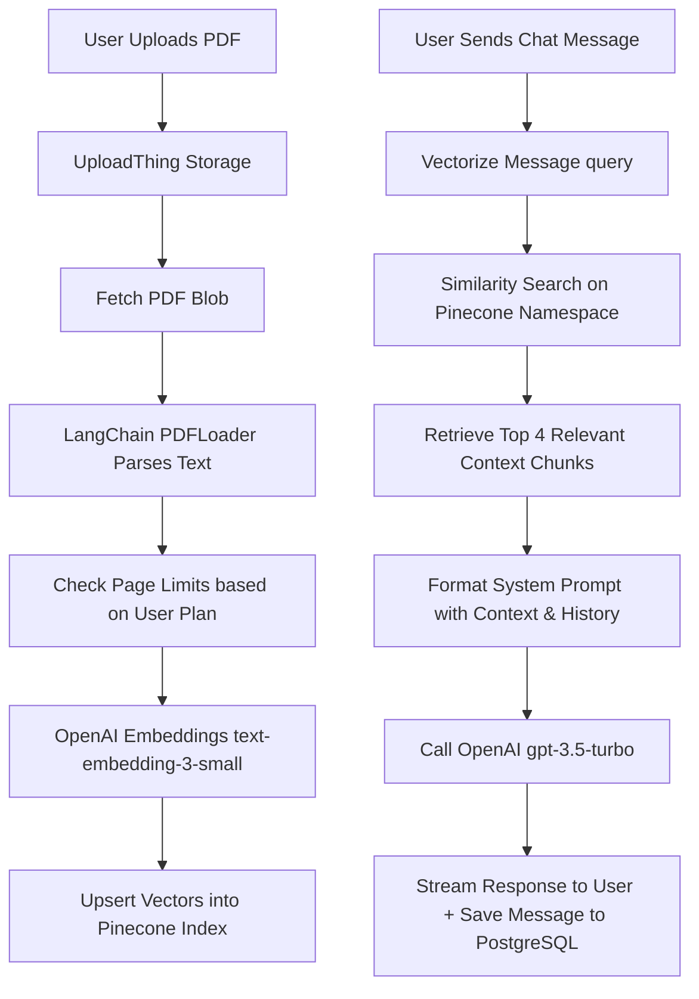

# 🧠 PaperMind AI

PaperMind AI is a modern, high-performance **Retrieval-Augmented Generation (RAG)** platform that enables users to upload PDF documents and have natural, context-aware conversations with them. 
**Live Demo:** https://papermind-ai.vercel.app/

Built using Next.js 15, Pinecone, LangChain, OpenAI, Prisma, Kinde Auth, and Razorpay, PaperMind AI offers a fast, secure, and type-safe user experience.

---

## 🚀 Key Features

*   **PDF File Uploads**: Upload documents securely up to 16MB (for Pro users) powered by **UploadThing**.
*   **Semantic Search & Chat**: Chat with documents using a state-of-the-art **RAG pipeline** that fetches relevant context from your PDF for accurate answers.
*   **Real-time Streaming**: LLM responses are streamed back to the client instantly using the Vercel AI SDK.
*   **Subscription & Billing**: Managed through a comprehensive **Razorpay** integration featuring a Free tier and a Pro tier.
*   **Seamless Authentication**: Secure login, registration, and logout flows powered by **Kinde Auth**.
*   **End-to-End Type Safety**: Complete type safety from database models to the frontend using **tRPC** and **Zod**.
*   **Modern Premium UI**: Clean, responsive dashboard design utilizing Tailwind CSS, Lucide icons, and Radix UI components.

---

## 🛠️ Technology Stack

| Component | Technology | Description |
| :--- | :--- | :--- |
| **Framework** | [Next.js 15](https://nextjs.org/) | App Router, Server Actions, React 19 |
| **Database & ORM** | [Prisma](https://www.prisma.io/) + PostgreSQL | Type-safe database querying and schema modeling |
| **Authentication** | [Kinde Auth](https://kinde.com/) | Secure user authentication and management |
| **Vector Storage** | [Pinecone](https://www.pinecone.io/) | High-performance vector database for semantic search namespaces |
| **Orchestration** | [LangChain](https://js.langchain.com/) | Document loading, embedding, and vector store helpers |
| **AI Models** | [OpenAI](https://openai.com/) | `text-embedding-3-small` for embeddings & `gpt-3.5-turbo` for responses |
| **Upload Service** | [UploadThing](https://uploadthing.com/) | Fast and reliable file upload handler |
| **Payment Gateway** | [Razorpay](https://razorpay.com/) | Subscription creation, verification, and plans management |
| **API Layer** | [tRPC](https://trpc.io/) + React Query | Typesafe API routing and query state caching |
| **Styling** | [Tailwind CSS v4](https://tailwindcss.com/) | Premium utility-first styling and micro-animations |

---

## 🗺️ How the RAG Pipeline Works



1.  **Ingestion**: When a PDF is uploaded, it is fetched from UploadThing, loaded page-by-page using `@langchain/community/document_loaders/fs/pdf`, and mapped to standard document schemas.
2.  **Vectorization**: The documents are embedded using OpenAI's `text-embedding-3-small` model and saved inside a Pinecone vector index (`papermind`) under a unique namespace corresponding to the file ID.
3.  **Retrieval**: When a query is sent, the system performs a similarity search inside Pinecone to retrieve the top 4 most relevant text segments.
4.  **Generation**: The system formats the prompt containing the retrieved context, the user's message, and previous message history, prompting `gpt-3.5-turbo` to answer the question, streaming the response to the user.

---

## 📂 Project Directory Structure

```text
├── prisma/
│   └── schema.prisma        # Database models (User, File, Message)
├── public/                  # Static assets and worker files
└── src/
    ├── app/                 # Next.js 15 pages, layouts, and API routes
    │   ├── api/             # API handlers (Message, UploadThing, Razorpay)
    │   ├── dashboard/       # Dashboard interface and per-file chat pages
    │   └── pricing/         # Pricing plan comparison page
    ├── components/          # Reusable React components (Chat, PDF Renderer, UI elements)
    ├── config/              # App configurations (plans, query limits)
    ├── db/                  # Prisma client instance caching
    ├── lib/                 # Core SDK clients (OpenAI, Pinecone, Razorpay, UploadThing)
    ├── trpc/                # tRPC backend router and frontend provider hooks
    ├── types/               # Custom typescript declarations
    └── middleware.ts        # Kinde auth page protection middleware
```

---

## ⚙️ Environment Variables Setup

Before running the project, create a `.env` file in the root directory. You can copy the template from [.env.example](file:///d:/PaperMind%20AI/.env.example):

```bash
cp .env.example .env
```

Ensure you fill in the following variables:

```ini
# Database Connection URL (PostgreSQL)
DATABASE_URL=""

# Kinde Auth Configuration
KINDE_CLIENT_ID=""
KINDE_CLIENT_SECRET=""
KINDE_ISSUER_URL=""
KINDE_SITE_URL="http://localhost:3000"
KINDE_POST_LOGOUT_REDIRECT_URL="http://localhost:3000"
KINDE_POST_LOGIN_REDIRECT_URL="http://localhost:3000/dashboard"

# UploadThing configuration token
UPLOADTHING_TOKEN=""

# OpenAI API Key
OPENAI_API_KEY=""

# Pinecone Vector DB API Key
PINECONE_API_KEY=""

# Razorpay Subscription Billing
NEXT_PUBLIC_RAZORPAY_KEY_ID=""
RAZORPAY_SECRET_ID=""
NEXT_PUBLIC_RAZORPAY_PLAN_ID=""

# Application configuration URL
NEXT_PUBLIC_BASE_URL="http://localhost:3000"
```

---

## 🏃 Getting Started

### 📋 Prerequisites

Make sure you have the following installed on your machine:
*   [Node.js](https://nodejs.org/) (v18 or higher recommended)
*   [pnpm](https://pnpm.io/) (used for package management)
*   [PostgreSQL](https://www.postgresql.org/) database

### 1. Install Dependencies

Install the project dependencies using `pnpm`:

```bash
pnpm install
```

### 2. Database Sync & Generation

Create your database schema using Prisma and generate the Prisma Client:

```bash
# Generate the Prisma Client
pnpm prisma generate

# Apply the migrations to your database
npx prisma db push
```

### 3. Start Development Server

Run the application locally:

```bash
pnpm dev
```

Open [http://localhost:3000](http://localhost:3000) in your browser to view the application.

---

## 📦 Package Scripts

| Script | Command | Purpose |
| :--- | :--- | :--- |
| `pnpm dev` | `next dev` | Start development server |
| `pnpm build` | `next build` | Build production application bundle |
| `pnpm start` | `next start` | Run production build server |
| `pnpm lint` | `next lint` | Run ESLint check for codebase validation |
| `pnpm postinstall` | `prisma generate` | Automatically re-generate Prisma client |

---

## 💳 Subscription Plans

| Feature | Free Plan | Pro Plan |
| :--- | :--- | :--- |
| **Monthly Cost** | ₹0 | ₹1,200 |
| **File Upload Quota** | 10 uploads | 50 uploads |
| **Max Pages per PDF** | 5 pages | 25 pages |
| **Max File Size** | 4 MB | 16 MB |
| **Support** | Standard | Priority |

---

## 📄 License

This project is private and proprietary. All rights reserved.

---

*Made with ❤️ by Sarthak Mehta*

